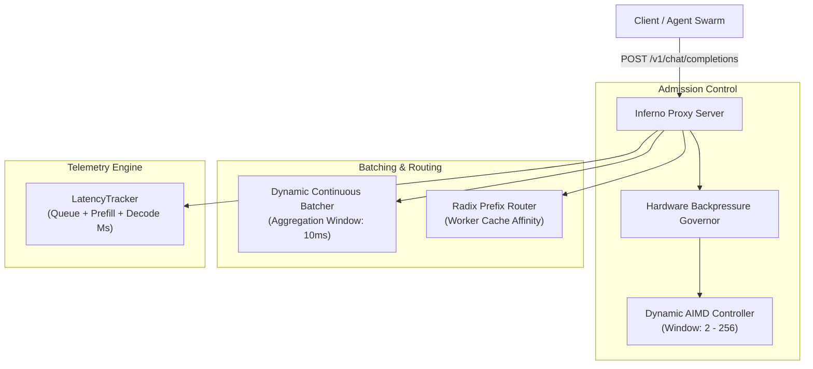

# Architecture Specification: inferno-telemetry-proxy

## 1. System Architecture Diagram

---

## 2. Component Blueprint
- **`pkg/proxy/server.go`**: Reverse proxy implementing continuous batching, streaming chunk flushers, and AIMD slot management.
- **`pkg/hardware/aimd.go`**: TCP-Vegas style concurrency window sizing with additive increase and multiplicative decrease.
- **`pkg/batcher/batcher.go`**: High-concurrency request item aggregator flushing batches on timeout or size saturation.
- **`pkg/routing/router.go`**: Longest-prefix match solver directing prompts to workers with warm KV caches.
- **`pkg/proxy/load_test.go`**: High-concurrency burst benchmark and stress test suite.
